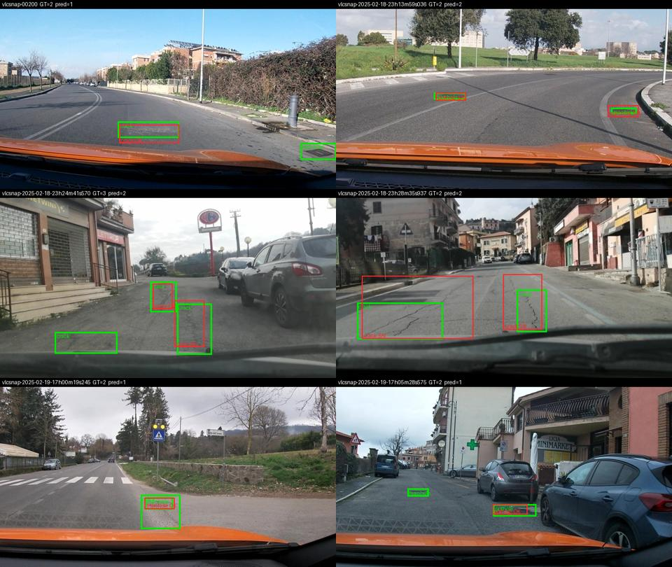

Họ tên: Hieu Pham
`dataset_version`: d10-21e4070301

## Bảng tổng hợp (số của bạn, lấy từ `report/evidence/*.json`)

| Mã | Setup | Tham số huấn luyện | VRAM đỉnh (GB) | Phút | F1 | CI95 | FP/ảnh | F1 pothole | F1 crack | F1 manhole |
|---|---|---|---|---|---|---|---|---|---|---|
| E0 | zero-shot | 0 | – | – | 0,096 | 0,071–0,126 | 0,79 | 0,131 | 0,035 | 0,190 |
| E1 | LoRA LLM | 33.030.144 | 6,37 | 39,9 | 0,278 | 0,242–0,317 | 1,26 | 0,149 | 0,207 | 0,553 |
| E2 | + projector | 142.135.296 | 8,06 | 40,6 | 0,336 | 0,296–0,378 | 1,12 | 0,152 | 0,280 | 0,592 |
| E3 | + LoRA ViT | 148.426.752 | 8,24 | 48,9 | **0,433** | 0,393–0,480 | 0,83 | 0,278 | 0,365 | 0,688 |
| E4 | data_size = 0,1 (setup <điền>) | | | | | | | | | |
| E4 | data_size = 1,0 (= <điền>) | | | | | | | | | |

Mọi lần chạy: Colab T4 16 GB, QLoRA NF4 (ViT và `lm_head` fp16), r = 16, alpha = 32, lr 2e-4 (warmup 5% + cosine), batch 2 × tích luỹ 4, 300 bước, seed 42. Mã: `lab/vlm.py`; lệnh: `lab_day10.ipynb`.



## 10 câu hỏi (trả lời bằng **số của bạn**, không chép lại tài liệu)

### Câu 1 — Kiến trúc: ViT, projector và LLM của Qwen3-VL-4B có bao nhiêu tham số mỗi khối, và E1/E2/E3 mỗi cái cập nhật khối nào?
Đếm bằng `named_parameters()` trên model dựng ở thiết bị `meta`: tổng **4.437.815.808**.
- **ViT** (`model.visual`, 24 block): 306.242.560 cho patch embed + các block.
- **Projector**: `visual.merger` 27.271.680 + `visual.deepstack_merger_list` 81.833.472 (3 merger cho đặc trưng lớp 5, 11, 17 của ViT) = **109.105.152**. Toàn bộ `model.visual` là 415.347.712.
- **LLM** (`model.language_model`, 36 lớp, gồm embedding): 4.022.468.096; `lm_head` dùng chung trọng số với embedding (`tie_word_embeddings=True`).

Khối được cập nhật:
- **E1**: chỉ LoRA trên 252 linear của LLM (q/k/v/o + gate/up/down × 36), **33.030.144** tham số.
- **E2**: E1 + toàn bộ projector, 33.030.144 + 109.105.152 = **142.135.296**.
- **E3**: E2 + LoRA trên 96 linear của ViT (qkv/proj/fc1/fc2 × 24), tổng 348 module, **148.426.752** tham số (LoRA ViT thêm 6.291.456).

Trong cả ba setup, trọng số gốc 4-bit của LLM và ViT luôn đóng băng.

### Câu 2 — E0: `parse_valid_rate` bằng bao nhiêu, và hai lỗi phổ biến nhất của model gốc là gì (kèm một ví dụ output thô)?
`parse_valid_rate` = **0,952**: 15/311 output hỏng. Model gốc không bọc ```json, không thêm chữ thừa (0/311 có fence), và luôn dùng đúng thang 0–1000. Hai lỗi chính:
1. **Lặp vô hạn đến khi bị cắt ở 256 token**. Cả 15 output hỏng đều là một chuỗi box `crack` dịch đều từng bước, rồi JSON bị cắt giữa chừng. Ví dụ `vlcsnap-2025-02-18-23h14m37s362`:
   `[{"label":"crack","bbox_2d": [520, 309, 550, 324]}, {"label":"crack","bbox_2d": [520, 324, 550, 338]}, {"label":"crack","bbox_2d": [520, 338, 550, 352]}, …` (bị cắt).
2. **Bỏ sót nặng và box lệch**. 238/311 ảnh chỉ trả đúng 1 box và 43 ảnh trả `[]`, trong khi test có 583 box (≈ 1,9 box/ảnh). Recall chỉ 0,072. Crack tệ nhất (P = 0,049, F1 = 0,035), vì model vẽ box rất dài kiểu `[0, 675, 1000, 750]` phủ cả bề ngang đường, không khớp các đoạn nứt nhỏ đã gán nhãn.

### Câu 3 — Thang 0–1000: nếu chấm output theo pixel (hoặc ngược lại) thì F1 ra sao và vì sao? Bạn đã kiểm chứng điều này thế nào?
Tôi chấm lại **cùng một file** dự đoán bằng `--coord pixel`:
- E1: F1 **0,278 → 0,000** (P = R = 0, meanIoU = 0), dù `parse_valid_rate` vẫn 0,997.
- E0: F1 **0,096 → 0,000**.

Lý do: khi coi số 0–1000 là pixel, `score.py` nhân x với 1000/640 và y với 1000/360. Một box `[430,467,583,506]` thành `[672,1297,911,1406]`, nằm ngoài khung theo trục y (> 1000). IoU với box thật luôn < 0,5, nên mọi dự đoán thành FP. Chiều ngược lại (model trả pixel mà chấm như 0–1000) cũng hỏng: box bị co về góc trên trái và lệch tỉ lệ dọc/ngang khác nhau (640 vs 360).

Đây là lỗi im lặng: JSON vẫn hợp lệ, chỉ F1 về 0. Vì vậy tôi kiểm tra round-trip ngay khi tạo nhãn (`lab/vlm.py check`: nhãn 0–1000 đổi ngược về pixel lệch < 1 px so với YOLO gốc). Qwen3-VL được huấn luyện grounding trên thang tương đối 0–1000, nên dùng đúng thang này thì zero-shot đã ra box hợp lý (meanIoU 0,60 ở các cặp khớp).

### Câu 4 — Mask loss: vì sao chỉ tính loss trên phần trả lời? Điều gì xảy ra nếu tính trên cả prompt và token ảnh?
Đo trên 29 ảnh train (cứ 50 ảnh lấy 1): một ví dụ dài trung vị **376 token**. Trong đó **317 token là prompt**, gồm **220 token ảnh** (`<|image_pad|>`, ảnh 640×360 → lưới 20×11 sau khi gộp 2×2) và 97 token chữ/template. Phần trả lời chỉ **59 token** (trung vị; dài nhất 250): JSON đáp án và `<|im_end|>\n`. `encode_example` kiểm tra prompt là tiền tố của chuỗi đầy đủ rồi đặt `labels[:n_prompt] = -100`. Tôi giải mã các token có `labels != -100` và nhận đúng `[{"label":"crack","bbox_2d":[430,467,583,506]},…]<|im_end|>\n`.

Nếu tính loss trên cả prompt:
- **Gradient bị pha loãng**: khoảng 84% token (317/376) là prompt giống hệt nhau ở mọi mẫu, nên model chỉ học thuộc câu lệnh. Loss nhìn thì giảm nhanh, nhưng phần lớn gradient không dạy gì về box.
- **Token ảnh là placeholder**: chúng không phải từ cần dự đoán. Bắt LM "đoán" `<|image_pad|>` là mục tiêu vô nghĩa, kéo lệch phân phối đầu ra.
- **Loss khó đọc**: không còn so được loss giữa các setup theo chất lượng box.

Ngoài ra, phải giữ `<|im_end|>` trong labels để model học dừng. E0 thiếu tín hiệu này với bài toán của tôi và lặp tới 256 token. Sau SFT, parse hợp lệ lên 0,997 (E1) và 1,000 (E2).

### Câu 5 — Vì sao không thể huấn luyện đầy đủ projector nếu ViT bị lượng tử hoá 4-bit, và bạn đã xử lý thế nào? Vì sao projector phải ở float32?
Khi lượng tử hoá, trọng số `Linear` thành `Params4bit`: các số NF4 đóng gói 2 giá trị/byte (uint8), cộng hằng số tỉ lệ theo khối. Đây không phải tensor số thực nên không có gradient hay bước AdamW lên nó. Chỉ có thể gắn LoRA bên cạnh, không thể "mở" toàn bộ projector.

Tôi gặp đúng lỗi này. Với `llm_int8_skip_modules=["visual","lm_head"]` như pseudo code, lần chạy thử đếm projector chỉ được **54.579.200** tham số, đúng bằng một nửa 109.105.152 vì 2 giá trị/byte. Tổng model chỉ 2,45B thay vì ~2,65B. Nguyên nhân: transformers 5.19 so khớp tên bằng `re.match` (từ đầu tên) hoặc `endswith`, nên `"visual"` không khớp `"model.visual.merger.linear_fc1"`, và cả ViT bị nén 4-bit. Sửa thành `"model.visual"` thì projector đếm đủ 109.105.152 và E2 có đúng 33.030.144 + 109.105.152 tham số huấn luyện.

Projector để float32 vì tôi huấn luyện với fp16 autocast + `GradScaler`. `GradScaler.unscale_` từ chối gradient fp16. Bước cập nhật AdamW với lr ~1e-5–2e-4 trên trọng số fp16 (10 bit mantissa) cũng hay bị làm tròn mất, và m/v của Adam dễ tràn hoặc mất độ chính xác. Giữ master weight float32 thì forward vẫn chạy fp16 dưới autocast, còn cập nhật thì chính xác.

### Câu 6 — Split theo phiên quay: vì sao chia ngẫu nhiên sẽ cho F1 cao giả? Số ảnh và số box từng lớp ở mỗi split là bao nhiêu?
Ảnh là frame cắt từ video dashcam, nên hai frame liền nhau gần như trùng (cùng ổ gà, cùng góc nhìn). Chia ngẫu nhiên thì hầu như ảnh test nào cũng có "anh em" gần giống trong train. Model chỉ cần nhớ thuộc vị trí box là đạt F1 cao, nhưng con số đó không nói gì về khả năng tổng quát sang một con đường hay một buổi quay mới. `prepare_data.py` gom theo phiên (ngày + giờ trong tên file) và gán cả phiên vào một split. Notebook kiểm tra không phiên nào nằm ở hai split.

| Split | Ảnh | pothole | crack | manhole |
|---|---|---|---|---|
| train | 1.422 | 1.074 | 1.750 | 691 |
| val | 276 | 66 | 470 | 103 |
| test | 311 | 121 | 299 | 163 |

Phân bố lệch rõ: val chỉ có 66 pothole; tỉ lệ crack:pothole ở train là 1,6 nhưng ở test là 2,5. Vì vậy F1 từng lớp trên test dao động mạnh và phải đọc kèm CI.

### Câu 7 — So sánh E1/E2/E3: mở projector và LoRA trên ViT có đáng không (F1, CI95, VRAM, thời gian)?

| | Tham số train | VRAM đỉnh | Phút | F1 (CI95) | FP/ảnh |
|---|---|---|---|---|---|
| E1 | 33,0M | 6,37 GB | 39,9 | 0,278 (0,242–0,317) | 1,26 |
| E2 | 142,1M (+109,1M) | 8,06 GB (+1,69) | 40,6 (+0,7) | 0,336 (0,296–0,378) | 1,12 |
| E3 | 148,4M (+6,3M) | 8,24 GB (+0,18) | 48,9 (+8,3) | **0,433** (0,393–0,480) | **0,83** |

**Mở projector (E1 → E2)**:
- **Chi phí:** chủ yếu là VRAM. 109M tham số float32 cần 0,44 GB trọng số + 0,44 GB gradient + 0,87 GB cho m và v của AdamW, khoảng 1,75 GB, khớp với mức tăng đo được (+1,69 GB). Thời gian gần như không đổi, vì gradient chỉ đi ngược tới đầu vào projector, không qua 24 block ViT.
- **Lợi ích:** F1 tăng 0,058, crack tăng nhiều nhất (0,207 → 0,280). Tuy vậy CI vẫn chồng với E1.

**LoRA trên ViT (E2 → E3)**:
- **Chi phí:** chỉ thêm 6,3M tham số và 0,18 GB VRAM, nhưng chậm hơn 20% (+8,3 phút), vì backward giờ phải đi qua toàn bộ ViT với gradient checkpointing.
- **Lợi ích:** F1 tăng 0,097, và CI không chồng với E2 (0,378 < 0,393). Precision tăng từ 0,351 lên 0,474, và FP/ảnh giảm từ 1,12 xuống 0,83. Cả ba lớp đều tăng: pothole 0,152 → 0,278, crack 0,280 → 0,365, manhole 0,592 → 0,688.

Cách giải thích của tôi: ViT được pretrain cho ảnh tổng quát. Hư hại mặt đường lại nhỏ (diện tích trung vị pothole 0,38% khung hình) và có kết cấu tinh, nên chỉ chỉnh LLM hay projector thì không tạo ra đặc trưng ViT còn thiếu.

**Đáng đồng tiền nhất là E3**: thêm 9 phút và 0,2 GB so với E2, nhưng F1 cao hơn E1 tới 0,155. Cả ba setup đều vừa T4 với dư nhiều VRAM (đỉnh 8,24/15 GB).

Hạn chế: tôi không chạy "LoRA ViT mà không mở projector", nên không tách được hai đóng góp này. Mỗi setup cũng chỉ có một seed.

### Câu 8 — Tập test có 311 ảnh: khoảng tin cậy rộng thế nào, và điều đó giới hạn kết luận so sánh các setup ra sao?
CI95 bootstrap (1.000 lần, lấy mẫu lại theo ảnh) rộng khoảng ±0,03–0,04 quanh F1:
- E0: 0,071–0,126 (rộng 0,055).
- E1: 0,242–0,317 (rộng 0,075).
- E2: 0,296–0,378 (rộng 0,082).
- E3: 0,393–0,480 (rộng 0,087).

Kết luận đứng vững: **mọi setup SFT hơn hẳn E0**, vì CI của E1 (từ 0,242) nằm hoàn toàn trên CI của E0 (đến 0,126).

Kết luận khá vững: **E3 > E2**. Chênh 0,097 và hai CI tách nhau (E2 tới 0,378, E3 từ 0,393), dù khe hở chỉ 0,015.

Kết luận yếu: E2 hơn E1 0,058 điểm F1, nhưng CI chồng nhau ở đoạn 0,296–0,317, nên chưa thể khẳng định chắc chắn.

Mỗi setup lại chỉ chạy một seed, nên phương sai do seed hay thứ tự dữ liệu chưa được tính vào CI. Thực tế, khoảng thật còn rộng hơn con số trên.

Theo lớp, CI còn rộng hơn: pothole test chỉ có 121 box, với E1 chỉ 15 TP, nên chênh lệch pothole giữa các setup (0,149 vs 0,152) hoàn toàn là nhiễu. Muốn so các setup gần nhau cần test lớn hơn, nhiều seed, hoặc bootstrap theo cặp (cùng ảnh cho hai setup).

### Câu 9 — Phân tích lỗi theo lớp: lớp nào kém nhất và vì sao (kích thước box, số mẫu, ngữ nghĩa)? Kèm ảnh minh hoạ.
Phân tích trên output E3 (setup tốt nhất). Recall tính theo diện tích box thật, đơn vị % khung hình:

| Lớp | F1 E3 | Diện tích trung vị (train) | Recall < 0,5% | 0,5–2% | > 2% | Số box dự đoán / thật (test) |
|---|---|---|---|---|---|---|
| pothole | **0,278** | 0,38% | 14/68 (21%) | 9/46 (20%) | 4/7 | 73 / 121 |
| crack | 0,365 | 1,35% | 1/15 (7%) | 44/136 (32%) | 65/148 (44%) | 303 / 299 |
| manhole | 0,688 | 0,39% | 27/64 (42%) | 67/96 (70%) | 2/3 | 116 / 163 |

**Pothole kém nhất**, vì ba lý do:
- **Box nhỏ:** 0,38% khung hình nghĩa là chỉ khoảng 30×30 px trên ảnh 640×360, tức vài patch 16 px trong 220 token ảnh.
- **Model quá dè dặt:** chỉ trả 73 box cho 121 pothole (recall 0,22). Một phần là do ít dữ liệu hơn: train có 1.074 pothole so với 1.750 crack.
- **Dễ lẫn ngữ nghĩa:** ổ gà dễ lẫn với vũng bóng, miếng vá và nắp cống. Có 6 pothole bị gán thành crack.

**Manhole** cũng nhỏ không kém (0,39%) nhưng tốt nhất (precision 0,83), vì hình dạng tròn/vuông kim loại rất đặc trưng.

**Crack** có số box dự đoán gần đúng (303/299) nhưng 193 FP. Recall tăng theo kích thước, từ 7% lên 44%. Lỗi chủ yếu là **ranh giới**: một vết nứt dài được người gán nhãn chia thành nhiều đoạn, hoặc gộp thành một box, không theo quy tắc nhất quán, nên box model vẽ đúng vết nứt vẫn có IoU < 0,5.

Nhầm lớp thật sự ít: chỉ 27 box khớp vị trí nhưng sai lớp (nhiều nhất manhole → crack 9, manhole → pothole 6). Phần lớn lỗi là **bỏ sót** (350 FN) và **box lệch hoặc sai kích thước**.

Ảnh minh hoạ `report/figures/pred_vs_gt.jpg` gồm 6 ảnh test. Box thật màu xanh lá, box dự đoán màu đỏ, nhãn `OK` nếu khớp IoU ≥ 0,5 cùng lớp, `SAI` nếu không. Từ trái sang phải, trên xuống dưới:
1. `vlcsnap-00200`: crack đúng; bỏ sót manhole bị nắp capo che một nửa ở góc phải dưới.
2. `…23h13m59s036`: 2 manhole ở xa. Model gán 1 thành manhole, 1 thành pothole, nhưng cả hai box lệch nên 0 TP.
3. `…23h24m41s570`: 3 crack, đúng 2 và bỏ sót 1 crack ở góc trái dưới.
4. `…23h28m35s937`: 2 crack, model vẽ box to hơn hẳn nhãn, nên 0 TP dù nhìn đúng vết nứt. Đây là lỗi ranh giới crack điển hình.
5. `…17h00m19s245`: manhole đúng; bỏ sót crack.
6. `…17h05m28s575`: pothole đúng; bỏ sót manhole nhỏ ở giữa đường.

### Câu 10 — E4: bạn đổi biến nào, kết quả thế nào, và kết luận có đáng tin không?
<điền E4>

## Nhìn lại

<điền>
